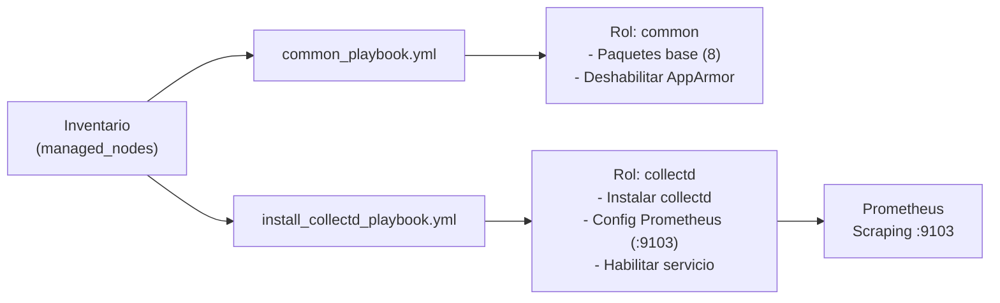

# ansible-sandbox

Repositorio de pruebas y automatización con **Ansible** orientado al aprovisionamiento base de nodos Linux (`managed_nodes`) y al despliegue de **collectd** con exportación de métricas para **Prometheus**.

---

## Estructura del Repositorio

```text
ansible-sandbox/
├── README.md                        # Documentación general del repositorio
├── common_playbook.yml              # Playbook de configuración base y AppArmor
├── install_collectd_playbook.yml    # Playbook de instalación y configuración de collectd
├── docs/
│   └── architecture.md              # Documentación técnica detallada, diagramas y hallazgos
├── common/                          # Rol de configuración base de nodos
│   ├── README.md                    # Documentación del rol common
│   ├── defaults/main.yml            # Variable por defecto: install_package: false
│   ├── handlers/main.yml            # Handler Reboot
│   ├── meta/main.yml                # Metadatos Galaxy del rol
│   ├── tasks/
│   │   ├── main.yml                 # Orquestador de tareas del rol common
│   │   ├── install_packages.yml     # Instalación de utilidades base
│   │   └── apparmor.yml             # Verificación, detención y deshabilitación de AppArmor
│   ├── tests/                       # Inventario y playbook de prueba base
│   └── vars/main.yml
└── collectd/                        # Rol de monitoreo con collectd + Prometheus
    ├── README.md                    # Documentación del rol collectd
    ├── defaults/main.yml
    ├── handlers/main.yml            # Handler Restart_collectd_service
    ├── meta/main.yml                # Metadatos Galaxy del rol
    ├── tasks/
    │   ├── main.yml                 # Orquestador de tareas del rol collectd
    │   ├── install_collectd.yml     # Instalación del paquete collectd
    │   ├── install_packages.yml     # (No incluido) Instalación de write_prometheus
    │   └── remove_collectd.yml      # (Vacío / No incluido) Placeholder de desinstalación
    ├── templates/
    │   └── template.j2              # Configuración /etc/collectd/collectd.conf.d/prometheus.conf
    ├── tests/                       # Inventario y playbook de prueba base
    └── vars/main.yml
```

---

## Vista General de Flujo



Para ver los **diagramas completos de arquitectura, flujo por rol, diagrama de secuencia y hallazgos de revisión técnica**, consulta:
- [Documentación de Arquitectura y Diagramas](docs/architecture.md)
- [Documentación del Rol `common`](common/README.md)
- [Documentación del Rol `collectd`](collectd/README.md)

---

## Playbooks Disponibles

| Playbook | Hosts Objetivo | Privilegios | Rol Aplicado | Resumen |
| :--- | :--- | :--- | :--- | :--- |
| [`common_playbook.yml`](common_playbook.yml) | `managed_nodes` | `become: yes` | `common` (`install_package: true`) | Instala utilidades base del sistema y detiene/deshabilita AppArmor si está activo. |
| [`install_collectd_playbook.yml`](install_collectd_playbook.yml) | `managed_nodes` | `become: yes` | `collectd` | Instala `collectd`, despliega la configuración del plugin `write_prometheus` en el puerto `9103` y asegura que el servicio quede activo y habilitado. |

---

## Uso Rápido

### 1. Requisitos previos
- Ansible instalado en el nodo de control (`>= 2.10` recomendado por el uso de FQCN `ansible.builtin.*`).
- Acceso SSH y permisos `sudo` (`become: yes`) hacia los nodos destino Linux con `systemd`.

### 2. Definir un inventario
El repositorio no incluye un inventario de producción por defecto. Crea un archivo `inventory.ini` con el grupo `managed_nodes`:

```ini
[managed_nodes]
node1.example.local ansible_user=ubuntu
node2.example.local ansible_user=ubuntu
```

### 3. Ejecutar los playbooks

```bash
# 1. Aprovisionamiento base (paquetes comunes + AppArmor)
ansible-playbook -i inventory.ini common_playbook.yml

# 2. Instalación y configuración de collectd con plugin de Prometheus
ansible-playbook -i inventory.ini install_collectd_playbook.yml
```

> **Nota importante:** Antes de ejecutar `common_playbook.yml` en nodos donde AppArmor esté activo, revisa los hallazgos documentados en [`docs/architecture.md`](docs/architecture.md#6-observaciones-técnicas-y-hallazgos-de-revisión) (especialmente la variable `disable_selinux` referenciada en el handler `Reboot`).