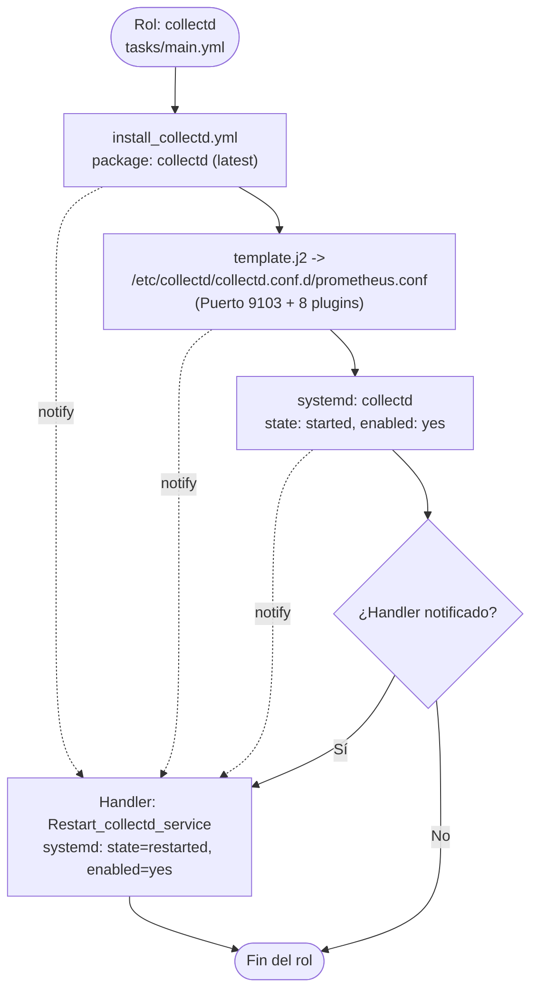

# Rol `collectd`

Rol de Ansible para instalar y configurar **collectd** en nodos Linux con soporte de exportación de métricas hacia **Prometheus** a través del plugin `write_prometheus` en el puerto `9103`.

---

## Requisitos

- Nodos Linux con `systemd` y directorio de configuración `/etc/collectd/collectd.conf.d/`.
- Privilegios de superusuario (`become: yes`).
- Repositorios del sistema configurados con el paquete `collectd` (y soporte para el plugin `write_prometheus`).

---

## Variables del Rol

Actualmente el rol **no define variables** en `defaults/main.yml` ni en `vars/main.yml`. La ruta de configuración (`/etc/collectd/collectd.conf.d/prometheus.conf`), el puerto (`9103`) y la lista de plugins están definidos de manera fija en `tasks/main.yml` y `templates/template.j2`.

---

## Tareas

### Tareas activas (`tasks/main.yml`)

1. **`include_tasks: install_collectd.yml`**
   - Instala o actualiza el paquete `collectd` mediante `ansible.builtin.package` (`state: latest`, `update_cache: yes`).
   - Notifica al handler `Restart_collectd_service`.
2. **`Deploy Write Prometheus plugin config`**
   - Despliega `templates/template.j2` en `/etc/collectd/collectd.conf.d/prometheus.conf` (`owner: root`, `group: root`, `mode: '0644'`).
   - Notifica al handler `Restart_collectd_service`.
3. **`Ensure collectd service is running and enabled`**
   - Asegura mediante `ansible.builtin.systemd` que el servicio `collectd` esté iniciado (`state: started`) y habilitado al arranque (`enabled: yes`).
   - Notifica al handler `Restart_collectd_service`.

### Archivos de tareas no incluidos

| Archivo | Contenido actual | Estado |
| :--- | :--- | :--- |
| `tasks/install_packages.yml` | Instala el paquete `write_prometheus` (`state: latest`, `update_cache: yes`) y notifica `Restart_collectd_service`. | No incluido en `tasks/main.yml` |
| `tasks/remove_collectd.yml` | Archivo vacío (0 bytes). | Placeholder sin implementar |

---

## Plantilla y Plugins Configurados (`templates/template.j2`)

La plantilla genera `/etc/collectd/collectd.conf.d/prometheus.conf` habilitando los siguientes plugins:

| Plugin | Configuración | Propósito |
| :--- | :--- | :--- |
| `write_prometheus` | `Port 9103` | Expone las métricas recolectadas en formato Prometheus sobre HTTP en el puerto `9103`. |
| `df` | Por defecto | Uso de espacio en disco por sistema de archivos. |
| `processes` | Por defecto | Estadísticas de procesos del sistema. |
| `protocols` | Por defecto | Métricas de protocolos de red (TCP/UDP/ICMP, etc.). |
| `swap` | Por defecto | Uso de memoria swap. |
| `tcpconns` | Por defecto | Número de conexiones TCP por estado. |
| `uptime` | Por defecto | Tiempo de actividad del sistema. |
| `users` | Por defecto | Número de usuarios conectados al sistema. |
| `vmem` | Por defecto | Métricas de memoria virtual (paginación, fallos de página). |

---

## Handlers

| Handler | Módulo | Acción |
| :--- | :--- | :--- |
| `Restart_collectd_service` | `ansible.builtin.systemd` | Reinicia el servicio `collectd` (`state: restarted`) y asegura `enabled: yes`. |

---

## Diagrama de Flujo del Rol



---

## Dependencias

Ninguna (`dependencies: []` en `meta/main.yml`).

---

## Ejemplo de Playbook

```yaml
---
- name: Install collectd
  hosts: managed_nodes
  become: yes
  roles:
    - role: collectd
```

---

## Observaciones

- **`update_cache: yes` con `ansible.builtin.package`:** `update_cache` es un parámetro específico de `ansible.builtin.apt` y no es portable en el módulo genérico `ansible.builtin.package`.
- **Notificación redundante:** La tarea `Ensure collectd service is running and enabled` notifica `Restart_collectd_service`, lo que causa un reinicio adicional si el servicio acababa de arrancarse.
- **Archivos sin usar:** `tasks/install_packages.yml` y `tasks/remove_collectd.yml` no están referenciados en `tasks/main.yml`.
- Consulta el análisis completo del repositorio en [`docs/architecture.md`](../docs/architecture.md).
