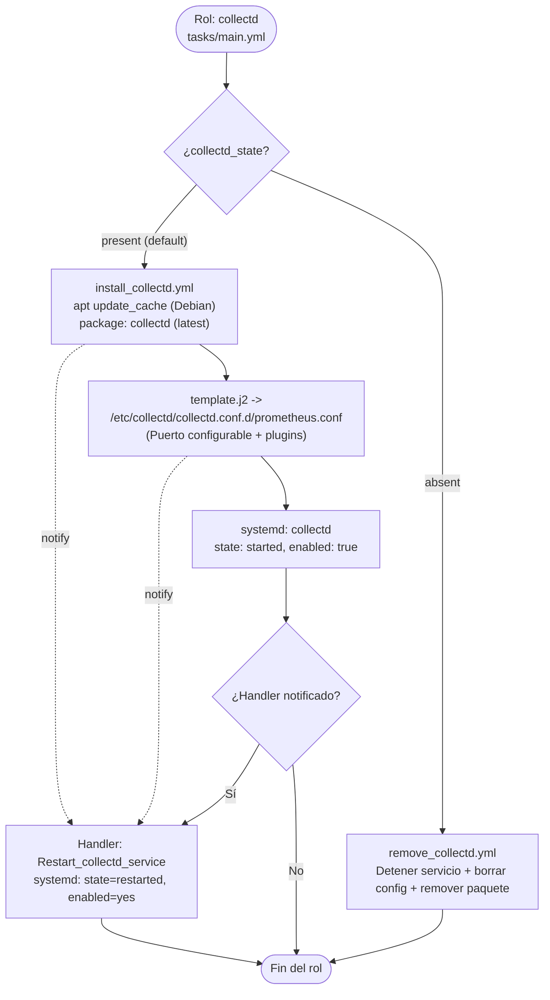

# Rol `collectd`

Rol de Ansible para instalar, configurar y desinstalar **collectd** en nodos Linux con soporte de exportación de métricas hacia **Prometheus** a través del plugin `write_prometheus` en el puerto `9103` (configurable).

---

## Requisitos

- Nodos Linux con `systemd` y directorio de configuración `/etc/collectd/collectd.conf.d/`.
- Privilegios de superusuario (`become: yes`).
- Repositorios del sistema configurados con el paquete `collectd` (y soporte para el plugin `write_prometheus`).

---

## Variables del Rol

### `defaults/main.yml`

| Variable | Tipo | Valor por defecto | Descripción |
| :--- | :--- | :--- | :--- |
| `collectd_state` | `string` | `present` | Estado deseado del rol: `present` instala y configura `collectd`; `absent` detiene el servicio, elimina la configuración y desinstala el paquete. |
| `collectd_prometheus_port` | `int` | `9103` | Puerto HTTP en el que el plugin `write_prometheus` expone las métricas. |
| `collectd_plugins` | `list[str]` | `[df, processes, protocols, swap, tcpconns, uptime, users, vmem]` | Lista de plugins de recolección de `collectd` cargados en `prometheus.conf`. |

---

## Tareas

### Cuando `collectd_state == 'present'` (`tasks/main.yml`)

1. **`ansible.builtin.include_tasks: install_collectd.yml`**
   - Actualiza la caché de `apt` (`cache_valid_time: 3600`) en nodos de la familia `Debian`.
   - Instala o actualiza el paquete `collectd` mediante `ansible.builtin.package` (`state: latest`).
   - Notifica al handler `Restart_collectd_service`.
2. **`Deploy Write Prometheus plugin config`**
   - Renderiza `templates/template.j2` en `/etc/collectd/collectd.conf.d/prometheus.conf` (`owner: root`, `group: root`, `mode: '0644'`).
   - Notifica al handler `Restart_collectd_service`.
3. **`Ensure collectd service is running and enabled`**
   - Asegura mediante `ansible.builtin.systemd` que el servicio `collectd` esté iniciado (`state: started`) y habilitado al arranque (`enabled: true`).

### Cuando `collectd_state == 'absent'` (`tasks/remove_collectd.yml`)

1. Comprueba si existe `collectd.service` en `systemd`.
2. Detiene y deshabilita el servicio `collectd` si existe.
3. Elimina `/etc/collectd/collectd.conf.d/prometheus.conf`.
4. Desinstala el paquete `collectd` (`state: absent`).

---

## Plantilla y Plugins Configurados (`templates/template.j2`)

La plantilla genera `/etc/collectd/collectd.conf.d/prometheus.conf` habilitando `write_prometheus` en el puerto `collectd_prometheus_port` y los plugins definidos en `collectd_plugins`:

| Plugin | Configuración | Propósito |
| :--- | :--- | :--- |
| `write_prometheus` | `Port {{ collectd_prometheus_port }}` (defecto `9103`) | Expone las métricas recolectadas en formato Prometheus sobre HTTP. |
| `df` | Por defecto | Uso de espacio en disco por sistema de archivos. |
| `processes` | Por defecto | Estadísticas de procesos del sistema. |
| `protocols` | Por defecto | Métricas de protocolos de red (TCP/UDP/ICMP, etc.). |
| `swap` | Por defecto | Uso de memoria swap. |
| `tcpconns` | Por defecto | Número de conexiones TCP por estado. |
| `uptime` | Por defecto | Tiempo de actividad del sistema. |
| `users` | Por defecto | Número de usuarios conectados al sistema. |
| `vmem` | Por defecto | Métricas de memoria virtual (paginación, fallos de página). |

---

## Handlers

| Handler | Módulo | Acción |
| :--- | :--- | :--- |
| `Restart_collectd_service` | `ansible.builtin.systemd` | Reinicia el servicio `collectd` (`state: restarted`) y asegura `enabled: yes`. |

---

## Diagrama de Flujo del Rol



---

## Dependencias

Ninguna (`dependencies: []` en `meta/main.yml`).

---

## Ejemplo de Playbook

```yaml
---
- name: Install collectd
  hosts: managed_nodes
  become: yes
  roles:
    - role: collectd
      vars:
        collectd_state: present
        collectd_prometheus_port: 9103
```

Consulta el análisis completo del repositorio en [`docs/architecture.md`](../docs/architecture.md).
