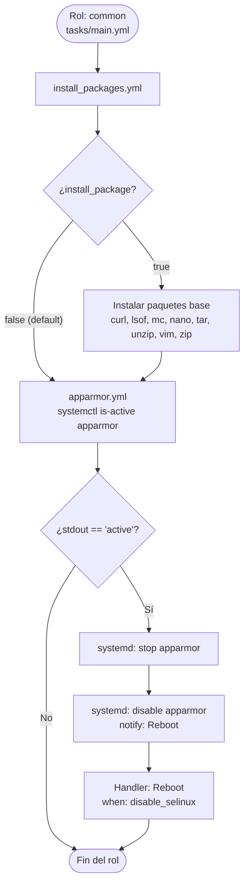

# Rol `common`

Rol de Ansible encargado del aprovisionamiento base de nodos Linux: instala un conjunto de utilidades comunes de administración y deshabilita el servicio **AppArmor** si se encuentra activo.

---

## Requisitos

- Nodos Linux con `systemd` (utiliza `systemctl is-active apparmor` y `ansible.builtin.systemd`).
- Privilegios de superusuario (`become: yes`).
- Ansible con soporte para módulos `ansible.builtin.*`.

---

## Variables del Rol

### `defaults/main.yml`

| Variable | Tipo | Valor por defecto | Descripción |
| :--- | :--- | :--- | :--- |
| `install_package` | `bool` | `false` | Controla si se ejecuta la tarea de instalación de paquetes base en `tasks/install_packages.yml`. En `common_playbook.yml` se sobrescribe a `true`. |

### Variables referenciadas externamente

| Variable | Ubicación | Observación |
| :--- | :--- | :--- |
| `disable_selinux` | `handlers/main.yml` | Referenciada en la condición `when: disable_selinux` del handler `Reboot`, pero **no está definida** en `defaults/main.yml` ni en `vars/main.yml`. Ver [Observaciones](#observaciones). |

---

## Tareas

El archivo `tasks/main.yml` incluye secuencialmente dos archivos de tareas:

1. **`tasks/install_packages.yml`**
   - Se ejecuta únicamente cuando `install_package` es `true`.
   - Utiliza `ansible.builtin.package` (`state: present`, `become: yes`) para instalar:
     - `curl`
     - `lsof`
     - `mc`
     - `nano`
     - `tar`
     - `unzip`
     - `vim`
     - `zip`

2. **`tasks/apparmor.yml`**
   - Verifica el estado actual con `ansible.builtin.command: "systemctl is-active apparmor"` y guarda el resultado en `apparmor_status` (`failed_when: false`, `changed_when: false`).
   - Si `apparmor_status.stdout == 'active'`:
     - Detiene el servicio `apparmor` (`state: stopped`).
     - Deshabilita el servicio `apparmor` en el arranque (`enabled: no`) y notifica al handler `Reboot`.

---

## Handlers

| Handler | Módulo | Acción | Condición |
| :--- | :--- | :--- | :--- |
| `Reboot` | `ansible.builtin.reboot` | Reinicia el nodo con `reboot_timeout: 300` | `when: disable_selinux` |

---

## Diagrama de Flujo del Rol



---

## Dependencias

Ninguna (`dependencies: []` en `meta/main.yml`).

---

## Ejemplo de Playbook

```yaml
---
- name: Install required common packages and disable AppArmor
  hosts: managed_nodes
  become: yes
  roles:
    - role: common
      vars:
        install_package: true
```

---

## Observaciones

- **Handler `Reboot` con variable indefinida:** En `handlers/main.yml`, el handler `Reboot` tiene la condición `when: disable_selinux`, la cual no está declarada en el rol. Si AppArmor está activo en el nodo destino, el handler será notificado y Ansible arrojará un error por variable no definida a menos que se pase `-e disable_selinux=false` (o `true`) o se corrija la condición en el handler.
- Consulta el análisis completo del repositorio en [`docs/architecture.md`](../docs/architecture.md).
