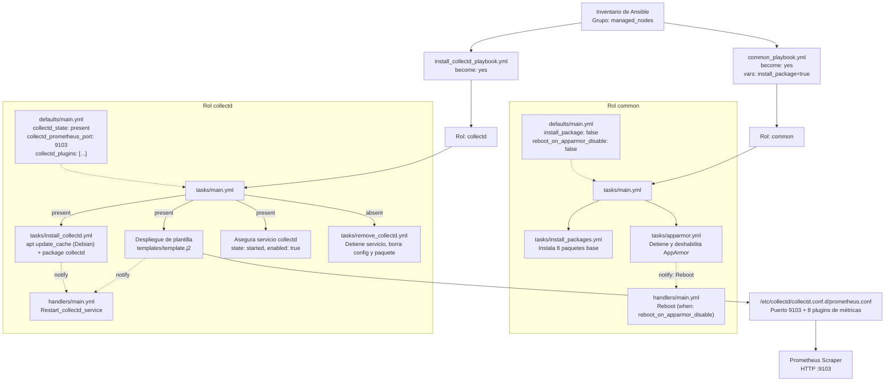
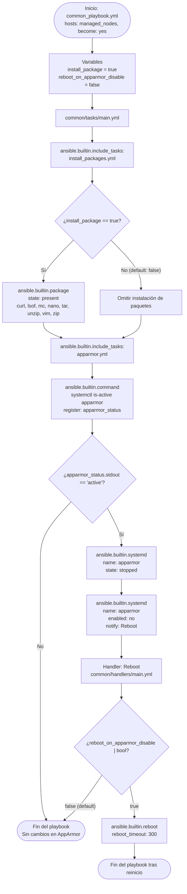
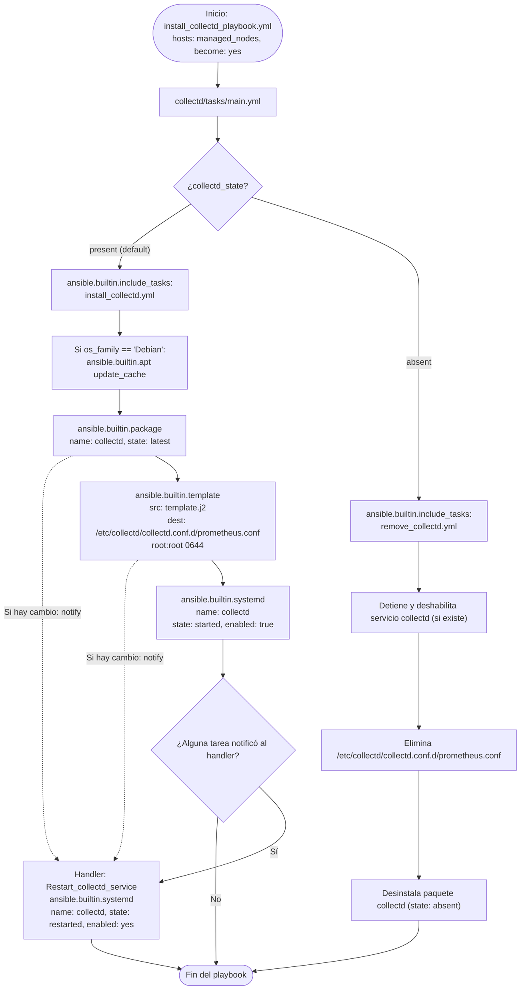
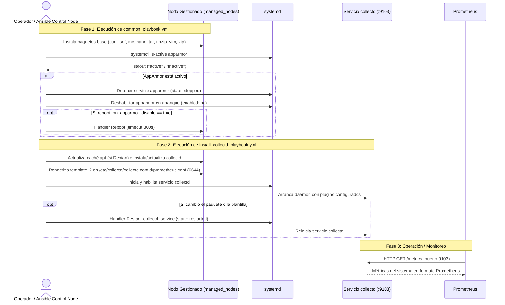

# Arquitectura, Documentación y Diagramas de Scripts

Este documento presenta el análisis técnico completo del repositorio **`ansible-sandbox`**, incluyendo diagramas de arquitectura, flujos de ejecución por playbook y rol, secuencia de interacción con los nodos gestionados, inventario detallado de archivos y estado de las mejoras aplicadas.

---

## 1. Arquitectura General del Repositorio

El repositorio está compuesto por **2 playbooks** en la raíz y **2 roles de Ansible** (`common` y `collectd`) orientados a aprovisionar nodos Linux definidos en el grupo de inventario `managed_nodes` con escalación de privilegios (`become: yes`).

---

## 2. Flujo de Ejecución: `common_playbook.yml` y Rol `common`

El playbook [`common_playbook.yml`](../common_playbook.yml) aplica el rol [`common`](../common/) sobrescribiendo `install_package: true` (su valor por defecto en `common/defaults/main.yml` es `false`).

---

## 3. Flujo de Ejecución: `install_collectd_playbook.yml` y Rol `collectd`

El playbook [`install_collectd_playbook.yml`](../install_collectd_playbook.yml) instala `collectd`, despliega la configuración parametrizada del plugin `write_prometheus` junto con 8 plugins de métricas del sistema y habilita el servicio mediante `systemd`. Si se define `collectd_state: absent`, ejecuta la desinstalación controlada con `remove_collectd.yml`.

---

## 4. Diagrama de Secuencia de Aprovisionamiento

Representación de la interacción temporal entre el nodo de control de Ansible, los nodos destino (`managed_nodes`) y un servidor de monitoreo Prometheus al ejecutar ambos playbooks en orden.

---

## 5. Inventario Detallado de Scripts y Archivos

| Archivo | Tipo | Propósito | Módulos Ansible | Variables / Handlers | Estado |
| :--- | :--- | :--- | :--- | :--- | :--- |
| `common_playbook.yml` | Playbook | Ejecuta el rol `common` sobre `managed_nodes` con `become: yes` | — | Define `install_package: true` | Activo |
| `install_collectd_playbook.yml` | Playbook | Ejecuta el rol `collectd` sobre `managed_nodes` con `become: yes` | — | Sin variables adicionales | Activo |
| `common/defaults/main.yml` | Defaults | Define valores por defecto del rol `common` | — | `install_package: false`, `reboot_on_apparmor_disable: false` | Activo |
| `common/vars/main.yml` | Vars | Archivo de variables del rol `common` | — | Vacío | Plantilla |
| `common/tasks/main.yml` | Tasks | Punto de entrada del rol `common`; incluye `install_packages.yml` y `apparmor.yml` | `ansible.builtin.include_tasks` | — | Activo |
| `common/tasks/install_packages.yml` | Tasks | Instala 8 utilidades base (`curl`, `lsof`, `mc`, `nano`, `tar`, `unzip`, `vim`, `zip`) | `ansible.builtin.package` | Condición: `when: install_package` | Activo |
| `common/tasks/apparmor.yml` | Tasks | Verifica, detiene y deshabilita el servicio `apparmor` si está activo | `ansible.builtin.command`, `ansible.builtin.systemd` | Registra `apparmor_status`; notifica `Reboot` | Activo |
| `common/handlers/main.yml` | Handlers | Reinicia el nodo tras deshabilitar AppArmor (timeout 300s) | `ansible.builtin.reboot` | Condición: `when: reboot_on_apparmor_disable \| bool` | Activo |
| `common/tests/test.yml` | Test | Playbook de prueba autogenerado por `ansible-galaxy init` | — | Apunta a `localhost` como `root` | Plantilla |
| `collectd/defaults/main.yml` | Defaults | Define valores por defecto del rol `collectd` | — | `collectd_state`, `collectd_prometheus_port`, `collectd_plugins` | Activo |
| `collectd/vars/main.yml` | Vars | Archivo de variables del rol `collectd` | — | Vacío | Plantilla |
| `collectd/tasks/main.yml` | Tasks | Orquesta instalación/configuración (`present`) o desinstalación (`absent`) de `collectd` | `ansible.builtin.include_tasks`, `ansible.builtin.template`, `ansible.builtin.systemd` | Notifica `Restart_collectd_service` solo al cambiar plantilla/paquete | Activo |
| `collectd/tasks/install_collectd.yml` | Tasks | Actualiza caché en Debian e instala `collectd` | `ansible.builtin.apt`, `ansible.builtin.package` | Notifica `Restart_collectd_service` | Activo |
| `collectd/tasks/remove_collectd.yml` | Tasks | Detiene servicio, elimina configuración Prometheus y desinstala `collectd` | `ansible.builtin.command`, `ansible.builtin.systemd`, `ansible.builtin.file`, `ansible.builtin.package` | Ejecutado cuando `collectd_state == 'absent'` | Activo |
| `collectd/templates/template.j2` | Template | Configuración parametrizada de plugins de `collectd` (`write_prometheus` + lista `collectd_plugins`) | — | Usa `collectd_prometheus_port` y `collectd_plugins` | Activo |
| `collectd/handlers/main.yml` | Handlers | Reinicia y habilita el servicio `collectd` | `ansible.builtin.systemd` | Handler `Restart_collectd_service` | Activo |
| `collectd/tests/test.yml` | Test | Playbook de prueba autogenerado por `ansible-galaxy init` | — | Apunta a `localhost` como `root` | Plantilla |

---

## 6. Correcciones Aplicadas y Recomendaciones Pendientes

### Hallazgos corregidos en `agent-review`

1. **Handler `Reboot` (`common/handlers/main.yml` y `common/defaults/main.yml`):** Se reemplazó la variable indefinida `disable_selinux` por `reboot_on_apparmor_disable` (con valor por defecto `false`).
2. **Actualización de caché portable (`collectd/tasks/install_collectd.yml`):** Se removió `update_cache: yes` de `ansible.builtin.package` y se agregó una tarea condicional con `ansible.builtin.apt` para sistemas `os_family == 'Debian'`.
3. **Limpieza e implementación de tareas en `collectd/tasks/`:** Se eliminó el archivo sin uso `collectd/tasks/install_packages.yml` y se implementó `collectd/tasks/remove_collectd.yml`, controlado mediante `collectd_state: present | absent`.
4. **Eliminación de notificación redundante (`collectd/tasks/main.yml`):** Se retiró `notify: Restart_collectd_service` de la tarea que inicia el servicio `collectd`.
5. **Parametrización de `collectd/templates/template.j2`:** Se parametrizaron `collectd_prometheus_port` y `collectd_plugins` desde `collectd/defaults/main.yml`.
6. **Consistencia de FQCN:** Se actualizó `include_tasks` a `ansible.builtin.include_tasks` en `common/tasks/main.yml` y `collectd/tasks/main.yml`.

### Recomendaciones opcionales a futuro

- Añadir un inventario de ejemplo (`inventory.ini.example`) y un `ansible.cfg` base en la raíz del proyecto.
- Agregar pruebas automatizadas con `ansible-lint` o Molecule en un flujo de CI.
