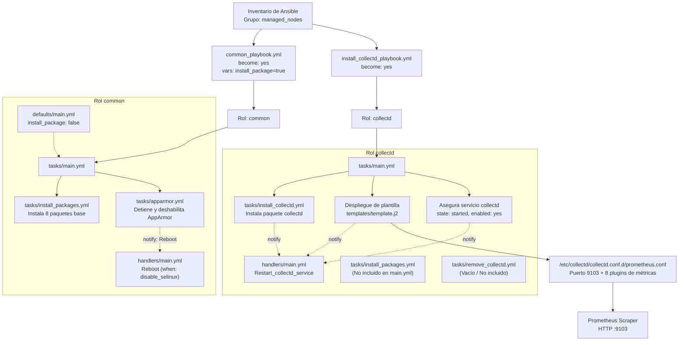
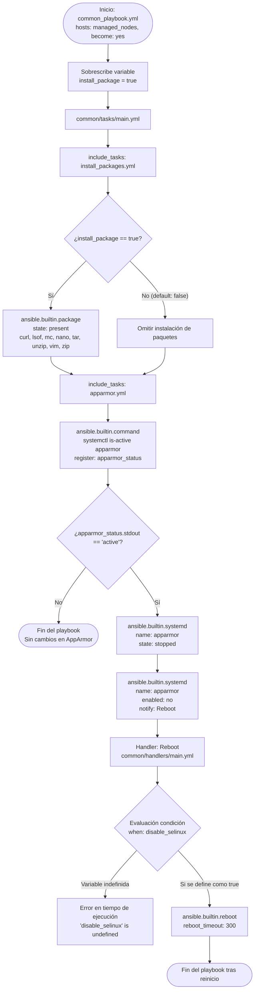
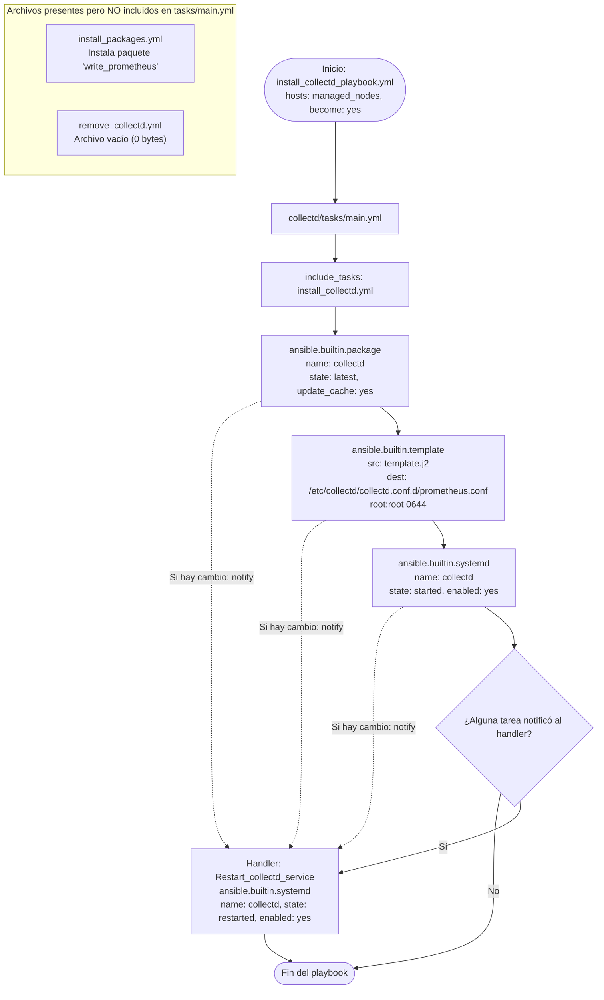
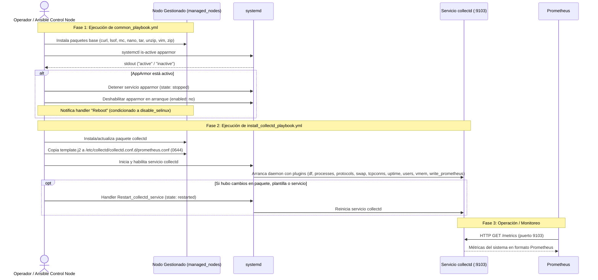

# Arquitectura, Documentación y Diagramas de Scripts

Este documento presenta el análisis técnico completo del repositorio **`ansible-sandbox`**, incluyendo diagramas de arquitectura, flujos de ejecución por playbook y rol, secuencia de interacción con los nodos gestionados, inventario detallado de archivos y observaciones técnicas detectadas durante la revisión.

---

## 1. Arquitectura General del Repositorio

El repositorio está compuesto por **2 playbooks** en la raíz y **2 roles de Ansible** (`common` y `collectd`) orientados a aprovisionar nodos Linux definidos en el grupo de inventario `managed_nodes` con escalación de privilegios (`become: yes`).

---

## 2. Flujo de Ejecución: `common_playbook.yml` y Rol `common`

El playbook [`common_playbook.yml`](../common_playbook.yml) aplica el rol [`common`](../common/) sobrescribiendo `install_package: true` (su valor por defecto en `common/defaults/main.yml` es `false`).

---

## 3. Flujo de Ejecución: `install_collectd_playbook.yml` y Rol `collectd`

El playbook [`install_collectd_playbook.yml`](../install_collectd_playbook.yml) instala `collectd`, despliega la configuración del plugin `write_prometheus` junto con 8 plugins de métricas del sistema y habilita el servicio mediante `systemd`.

---

## 4. Diagrama de Secuencia de Aprovisionamiento

Representación de la interacción temporal entre el nodo de control de Ansible, los nodos destino (`managed_nodes`) y un servidor de monitoreo Prometheus al ejecutar ambos playbooks en orden.

---

## 5. Inventario Detallado de Scripts y Archivos

| Archivo | Tipo | Propósito | Módulos Ansible | Variables / Handlers | Estado |
| :--- | :--- | :--- | :--- | :--- | :--- |
| `common_playbook.yml` | Playbook | Ejecuta el rol `common` sobre `managed_nodes` con `become: yes` | — | Define `install_package: true` | Activo |
| `install_collectd_playbook.yml` | Playbook | Ejecuta el rol `collectd` sobre `managed_nodes` con `become: yes` | — | Sin variables adicionales | Activo |
| `common/defaults/main.yml` | Defaults | Define el comportamiento por defecto del rol `common` | — | `install_package: false` | Activo |
| `common/vars/main.yml` | Vars | Archivo de variables del rol `common` | — | Vacío | Plantilla |
| `common/tasks/main.yml` | Tasks | Punto de entrada del rol `common`; incluye `install_packages.yml` y `apparmor.yml` | `include_tasks` | — | Activo |
| `common/tasks/install_packages.yml` | Tasks | Instala 8 utilidades base (`curl`, `lsof`, `mc`, `nano`, `tar`, `unzip`, `vim`, `zip`) | `ansible.builtin.package` | Condición: `when: install_package` | Activo |
| `common/tasks/apparmor.yml` | Tasks | Verifica, detiene y deshabilita el servicio `apparmor` si está activo | `ansible.builtin.command`, `ansible.builtin.systemd` | Registra `apparmor_status`; notifica `Reboot` | Activo |
| `common/handlers/main.yml` | Handlers | Reinicia el nodo tras cambios de seguridad (timeout 300s) | `ansible.builtin.reboot` | Condición: `when: disable_selinux` | Con hallazgo |
| `common/tests/test.yml` | Test | Playbook de prueba autogenerado por `ansible-galaxy init` | — | Apunta a `localhost` como `root` | Plantilla |
| `collectd/defaults/main.yml` | Defaults | Archivo de valores por defecto del rol `collectd` | — | Vacío | Plantilla |
| `collectd/vars/main.yml` | Vars | Archivo de variables del rol `collectd` | — | Vacío | Plantilla |
| `collectd/tasks/main.yml` | Tasks | Incluye `install_collectd.yml`, despliega `template.j2` y asegura servicio `collectd` | `include_tasks`, `ansible.builtin.template`, `ansible.builtin.systemd` | Notifica `Restart_collectd_service` | Activo |
| `collectd/tasks/install_collectd.yml` | Tasks | Instala el paquete `collectd` en su última versión | `ansible.builtin.package` | Notifica `Restart_collectd_service` | Con hallazgo |
| `collectd/tasks/install_packages.yml` | Tasks | Intenta instalar el paquete `write_prometheus` | `ansible.builtin.package` | Notifica `Restart_collectd_service` | Sin incluir |
| `collectd/tasks/remove_collectd.yml` | Tasks | Reservado para tareas de desinstalación de `collectd` | — | — | Vacío / Sin incluir |
| `collectd/templates/template.j2` | Template | Configuración de plugins de `collectd` (`write_prometheus` en puerto `9103` + 8 plugins de sistema) | — | Sin variables Jinja2 | Activo |
| `collectd/handlers/main.yml` | Handlers | Reinicia y habilita el servicio `collectd` | `ansible.builtin.systemd` | Handler `Restart_collectd_service` | Activo |
| `collectd/tests/test.yml` | Test | Playbook de prueba autogenerado por `ansible-galaxy init` | — | Apunta a `localhost` como `root` | Plantilla |

---

## 6. Observaciones Técnicas y Hallazgos de Revisión

Durante el análisis de los scripts se identificaron los siguientes puntos a tener en cuenta antes de ejecutarlos en entornos productivos:

1. **Variable indefinida en el handler `Reboot` (`common/handlers/main.yml`)**
   - El handler evalúa `when: disable_selinux`, pero dicha variable no existe en `common/defaults/main.yml`, `common/vars/main.yml` ni en `common_playbook.yml`.
   - Si AppArmor está activo en el nodo destino, la tarea de deshabilitación notificará al handler `Reboot` y Ansible fallará con `'disable_selinux' is undefined`.
   - **Recomendación:** Definir una variable explícita (por ejemplo `reboot_on_apparmor_disable: false` en `common/defaults/main.yml`) y actualizar la condición del handler.

2. **Parámetro `update_cache: yes` en `ansible.builtin.package` (`collectd/tasks/install_collectd.yml` y `collectd/tasks/install_packages.yml`)**
   - `ansible.builtin.package` es un módulo agnóstico de distribución que delega en el gestor de paquetes subyacente y no documenta `update_cache` como parámetro estándar multiplataforma (es específico de `ansible.builtin.apt`). En sistemas basados en `dnf`/`yum` o con validación estricta puede generar errores.
   - **Recomendación:** Usar `ansible.builtin.apt` (si el objetivo es Debian/Ubuntu) o actualizar la caché en una tarea condicional según `ansible_facts['os_family']`.

3. **Archivos de tareas no utilizados en el rol `collectd`**
   - `collectd/tasks/install_packages.yml` no se incluye desde `collectd/tasks/main.yml`, y el nombre de paquete `write_prometheus` no suele coincidir con el nombre real en repositorios estándar (en Debian/Ubuntu viene incluido en `collectd`/`collectd-core`; en RHEL/CentOS suele llamarse `collectd-write_prometheus`).
   - `collectd/tasks/remove_collectd.yml` está vacío (0 bytes).
   - **Recomendación:** Implementar la lógica de desinstalación (por ejemplo controlada por tags o una variable de estado) o eliminar los archivos no utilizados para evitar confusión.

4. **Notificación redundante al handler en `collectd/tasks/main.yml`**
   - La tarea `Ensure collectd service is running and enabled` incluye `notify: Restart_collectd_service`. Si el servicio estaba detenido y se inicia en esa tarea, inmediatamente volverá a reiniciarse al final del play.
   - **Recomendación:** Mantener `notify: Restart_collectd_service` solo en las tareas de instalación de paquetes y despliegue de configuración (`template`).

5. **Plantilla `collectd/templates/template.j2` sin parametrizar**
   - Aunque utiliza extensión `.j2` y el módulo `ansible.builtin.template`, no contiene expresiones Jinja2: el puerto `9103` y la lista de plugins están codificados de forma fija.
   - **Recomendación:** Exponer variables en `collectd/defaults/main.yml` (p. ej. `collectd_prometheus_port: 9103` y `collectd_plugins: [...]`) para hacer reutilizable el rol.

6. **Ausencia de inventario raíz y `ansible.cfg`**
   - Ambos playbooks apuntan a `hosts: managed_nodes`, pero no existe un archivo de inventario en la raíz del proyecto ni un `ansible.cfg` que documente la configuración por defecto.
   - **Recomendación:** Añadir un archivo `inventory.example` (o `inventory/hosts.ini.example`) y un `ansible.cfg` base.

7. **Consistencia de FQCN (Fully Qualified Collection Names)**
   - Las tareas usan `ansible.builtin.package`, `ansible.builtin.systemd`, `ansible.builtin.template` y `ansible.builtin.command`, pero las inclusiones usan la forma corta `include_tasks` en lugar de `ansible.builtin.include_tasks`.
